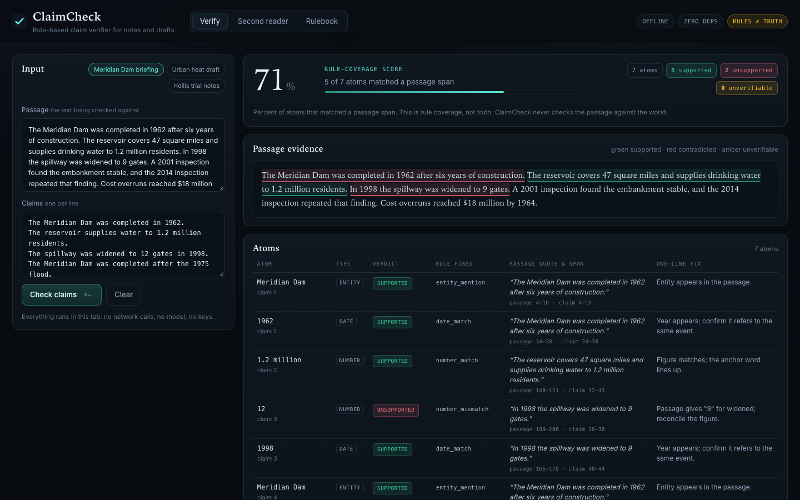
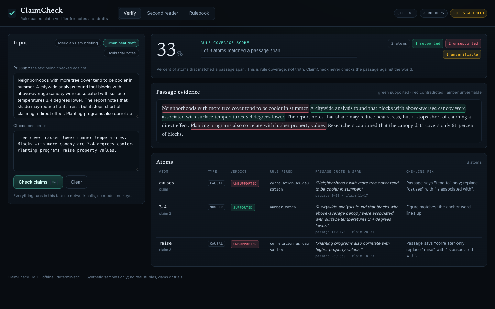
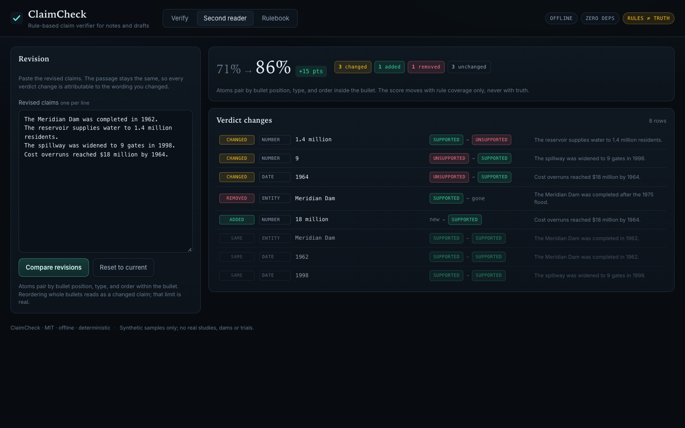

# ClaimCheck

**An offline, deterministic claim verifier for study notes and article drafts.**

Paste a passage, paste the bullets you wrote from it. ClaimCheck splits each bullet
into checkable atoms — a number, a date, a named entity, a causal assertion — then
walks the passage and marks every atom **SUPPORTED**, **UNSUPPORTED** or
**UNVERIFIABLE-IN-TEXT**, with the exact character span, the rule that fired, and a
one-line fix.

No network. No model. No API keys. No dependencies. The whole thing is static files
and about 1,000 lines of plain JavaScript.

```
Passage  →  atomize(claim)  →  rule per atom  →  verdict + span + rule + fix
```

Live demo: <https://aariv.me/claimcheck/>

## Why deterministic

Every other "check my notes" tool asks a language model. A model can hallucinate a
supporting span, change its answer between runs, and cannot tell you *why* it said
SUPPORTED. ClaimCheck is the opposite: the same input always produces the same table,
every verdict names the rule that produced it, and the exact span is printed so you
can audit it by hand.

That trade is explicit. ClaimCheck does not understand meaning, so it cannot catch a
paraphrase or a confidently wrong passage. It catches the errors that actually show up
in study notes and drafts: a number that drifted during copying, a year that moved, a
name that changed, a correlation written up as a cause, and a hedged finding stated
flatly.

## Quick start

Requires Node 22+ (only for the local server and tests; the app itself is browser-only).

```sh
node scripts/serve.mjs        # prints a 127.0.0.1 URL
node --test tests/*.test.mjs  # 53 tests
```

Or open `index.html` through any static server. Three synthetic samples are built in.

## How a verdict is chosen

Each atom asks one question: *can this be placed against a span in the passage, and
does that span agree?*

| Situation | Verdict |
|---|---|
| A span agrees with the atom | `SUPPORTED` |
| A span disagrees with the atom | `UNSUPPORTED` |
| No span can be found | `UNVERIFIABLE-IN-TEXT` |

Silence is never treated as disproof. A name the passage does not mention is
unverifiable, not false.

## Rule table

| Rule | Family | Verdict | Fires when |
|---|---|---|---|
| `number_match` | Numeric consistency | SUPPORTED | A figure in the claim matches a figure in a passage sentence about the same anchor word |
| `number_mismatch` | Numeric consistency | UNSUPPORTED | The passage discusses the same anchor but gives a different figure |
| `number_unit_mismatch` | Numeric consistency | UNSUPPORTED | Same digits, different unit (a percentage where the passage says a count) |
| `number_without_figure` | Numeric consistency | UNVERIFIABLE | The passage discusses the anchor but states no figure |
| `anchor_absent` | Numeric consistency | UNVERIFIABLE | The anchor word around the figure never appears in the passage |
| `date_match` | Date ordering | SUPPORTED | The year in the claim appears in the passage |
| `date_order_conflict` | Date ordering | UNSUPPORTED | Temporal cues build an impossible window (`after 2015 … before 2010`) |
| `date_mismatch` | Date ordering | UNSUPPORTED | The passage dates the same entity differently |
| `date_absent` | Date ordering | UNVERIFIABLE | The claim year is not in the passage |
| `entity_mention` | Entity mention | SUPPORTED | The named entity appears in the passage |
| `entity_variant` | Entity mention | UNSUPPORTED | A near-identical name appears but one token differs (Act vs Bill) |
| `entity_absent` | Entity mention | UNVERIFIABLE | The entity is never mentioned |
| `causal_supported` | Causal language | SUPPORTED | The passage makes the same causal move the claim makes |
| `correlation_as_causation` | Causal language | UNSUPPORTED | The claim asserts cause but the passage only reports association |
| `hedge_weakens_causal` | Causal language | UNSUPPORTED | The passage hedges (`may`, `suggests`, `preliminary`) while the claim is flat |
| `causal_unclear` | Causal language | UNVERIFIABLE | A matching passage sentence exists but carries no causal or correlational cue |
| `causal_no_basis` | Causal language | UNVERIFIABLE | No passage sentence shares enough wording to judge the causal claim |

### Atomization, concretely

- **NUMBER** — `\d` runs with optional thousands separators, decimals, and a unit
  (`%`, `percent`, `million`, `billion`, `thousand`). Years are excluded. Values are
  compared numerically, so `1.2 million` matches `1,200,000`. The **anchor** is the
  nearest content word before the figure ("9 **gates**" → `gates`), stemmed so
  `gate`/`gates` match.
- **DATE** — four-digit years from 1000 to 2099, extracted before numbers so a year is
  never double-counted. Ordering cues (`before`, `after`, `since`, `until`, `by`,
  `prior to`, `following`, `between … and`) become lower/upper bounds, and an empty
  window is reported as a conflict.
- **ENTITY** — runs of capitalized words with a leading determiner and months
  stripped. A lone capitalized word at the start of a claim is treated as sentence
  casing, not a name.
- **CAUSAL** — a fixed list of cue phrases (`causes`, `leads to`, `due to`, `drives`,
  `shortens`, `raises`, `because`, …). Each cue becomes one causal atom.

## The score is rule coverage, not truth

```
score = round(100 × SUPPORTED atoms / all atoms)
```

It is the share of atoms the rules could place against a span. It is **not** a
probability that the claim is correct, and the UI says so next to the number. A
perfect score means the draft is *traceable to the passage*, not that the passage is
right. A low score usually means the claim moved away from the source wording.

Empty input produces a null score, not 0 % — nothing was checked.

## Second reader

Paste a revised claim list and ClaimCheck re-runs the same pass on the same passage,
then diffs the two reports. Atoms pair by (bullet position, atom type, order of that
type inside the bullet), so a reworded bullet lines up with its earlier self and a
verdict change is visible: `SUPPORTED → UNSUPPORTED`, `+15 pts`, and so on.

Reordering whole bullets reads as changed claims — a real limit of positional pairing.

## Honest limits

- **Rules, not semantics.** Matching is lexical. A paraphrase that shares no
  vocabulary is `UNVERIFIABLE-IN-TEXT`.
- **No fact-checking against the world.** The passage is the only source. A
  confidently wrong passage yields confidently `SUPPORTED` atoms.
- **The score is coverage, not truth.**
- **Silence is not disproof.**
- **Atomization is shallow.** Pronouns, implicit entities, spelled-out numbers
  (`two days`), and rewritten units are missed.
- **Hedges are sentence-level.** One `may` anywhere in the matched sentence weakens a
  causal atom for the whole sentence.
- **Anchor selection is positional.** The word before the figure is the anchor; a
  claim that says "recovery shortened by 2 days" looks for `shortened`, not `recovery`
  (`number_without_figure` when the verb appears, `anchor_absent` when it does not).
- **English only.** The cue lists and entity casing rules are English.

## Screenshots

| | |
|---|---|
|  |  |
| Verify: 71% rule coverage, two contradictions with spans | The heat sample: causation claim, correlational passage |
|  | |
| Second reader: 71% → 86%, three verdicts flipped | |

## Samples

All three passages ship with the app and are synthetic — no real dam, study, trial, or
dataset is described.

| Sample | Exercises |
|---|---|
| Meridian Dam briefing | number and year matches, one drifted figure, one moved year |
| Urban heat draft | correlation written as causation, a figure that does match |
| Hollis trial notes | hedged causation, a spelled-out number, a coherent date window |

## Files

```
index.html            app shell
app.js                UI (imports the same modules the tests use)
styles.css            all styling, no external assets
src/atomize.js        atomization, cue lists, entity extraction
src/rules.js          the 17 verdict rules and their metadata
src/analyze.js        orchestration, score, passage marks
src/diff.js           second-reader comparison
src/samples.js        three synthetic samples + a revision
src/text.js           offsets, numbers, dates, sentence splitting
tests/                53 node:test cases
scripts/serve.mjs     dependency-free static server
scripts/screenshots.mjs  three 1440x900 headless captures
video/                narration, steps, demo.mp4
```

## AI disclosure

The code, tests, sample passages, README, and demo narration were produced with AI
assistance (Claude Code) and reviewed by the entrant. **The application itself uses no
AI model at runtime** — every verdict comes from the deterministic functions in
`src/rules.js`.

## License

MIT. See [LICENSE](LICENSE).
